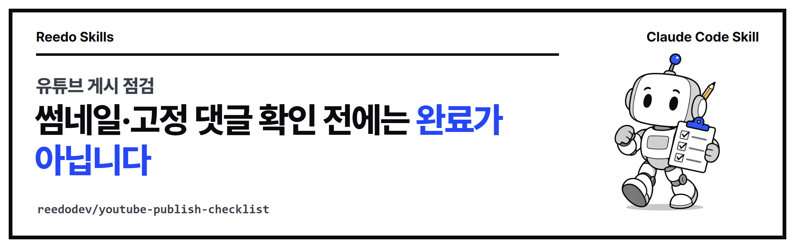

<p align="center"></p>

<p align="center">
<a href="https://github.com/reedodev/youtube-publish-checklist/actions/workflows/test.yml"></a>


</p>

# 유튜브 게시 점검 (youtube-publish-checklist)

롱폼과 쇼츠마다 맞춤 썸네일(규격·용량·채널 표시)과 고정 댓글을 확인하고, 예약 공개라면 공개 뒤 댓글을 달 후속 작업이 있는지까지 검사합니다. 하나라도 빠지면 '게시 완료'라고 보고하지 못하게 합니다.

## 처음 쓰시는 분을 위한 안내

### 이 스킬이 해결하는 문제

AI 에이전트에게 유튜브 업로드를 맡기면 영상 파일은 잘 올리는데, 업로드 **뒤에** 해야 하는 일을 자주 빼먹습니다. 이 스킬은 "올렸습니다"라고 보고하기 전에 영상마다 다음을 확인하게 합니다.

- 맞춤 썸네일이 규격(롱폼 16:9, 쇼츠 9:16, 2MB 이하)에 맞는지, 실제 채널 화면에 보이는지
- 고정 댓글이 달렸는지, 예약 공개라면 공개 뒤에 댓글을 달 후속 작업이 있는지

이런 상황에서 쓰시면 됩니다.

- 상황 1: 예약 공개로 올린 영상은 비공개 동안 댓글을 달 수 없는데, 공개 뒤에 댓글을 달 사람이 아무도 없는 경우
- 상황 2: "다른 곳에 올린 영상 그대로 올려 줘"라는 말을 썸네일 생략으로 잘못 알아들은 경우

### 용어 풀이

- **Claude Code**: 터미널에서 대화하듯 일을 시키는 AI 코딩 도우미입니다. 이 스킬은 Claude Code가 읽고 따르는 용도로 만들었습니다.
- **스킬**: 에이전트가 읽고 그대로 따르는 사용 설명서(`SKILL.md`)와 실행 도구를 한 폴더로 묶은 것입니다.
- **터미널**: 명령어를 글자로 입력하는 창입니다. Windows에서는 PowerShell, Mac에서는 "터미널" 앱입니다.
- **고정 댓글**: 댓글 맨 위에 항상 보이도록 영상 주인이 고정해 둔 댓글입니다.
- **예약 공개**: 정해 둔 시각에 자동으로 공개되도록 올리는 방식입니다. 공개 전에는 비공개 상태입니다.
- **종료 코드**: 프로그램이 끝날 때 남기는 숫자입니다. 0이면 통과, 1이면 빠진 항목 있음, 2면 사용법 문제입니다.

### 준비 확인

터미널에서 아래 명령을 입력해 숫자가 나오는지 봅니다.

```bash
node -v
```

`v18` 이상이면 됩니다. 모르는 명령이라고 나오면 [nodejs.org](https://nodejs.org)에서 LTS 버전을 설치합니다. 이 스크립트는 다른 프로그램이나 설치할 패키지 없이 Node만으로 동작합니다. 다만 실제 채널 화면 확인은 브라우저에서 YouTube Studio에 로그인해 직접 봅니다.

### 따라 하기 3단계

**1단계. 설치합니다.** Claude Code 안에서 아래 두 줄을 차례로 입력합니다.

```
/plugin marketplace add reedodev/youtube-publish-checklist
/plugin install youtube-publish-checklist@youtube-publish-checklist
```

**2단계. 에이전트에게 이렇게 말합니다.** 아래 문장을 그대로 복사해 쓰시면 됩니다.

1. `방금 올린 롱폼과 쇼츠를 youtube-publish-checklist로 점검해 줘. 확인하기 전에는 게시 완료라고 하지 마.`
2. `이 썸네일 thumb.png가 쇼츠 규격에 맞는지 보고해 줘.`
3. `이 영상은 예약 공개야. 공개 10분 뒤에 고정 댓글을 달 후속 작업도 같이 만들어 줘.`

**3단계. 결과를 확인합니다.** 영상마다 `OK` 또는 `FAIL`이 나옵니다. 전부 `OK`여야 종료 코드가 0이 되고, 그때에야 에이전트가 "게시 완료"라고 말할 수 있습니다.

### 실제로 실행한 결과

저장소에 들어 있는 연습용 파일(`skills/youtube-publish-checklist/examples/`)로 돌린 결과입니다. 실제 영상이 아니라 이름만 붙인 예시입니다.

썸네일 한 장을 검사합니다.

```
$ node skills/youtube-publish-checklist/scripts/publish-gate.mjs thumb skills/youtube-publish-checklist/examples/sample-long.png --kind long
OK   skills/youtube-publish-checklist/examples/sample-long.png 1280x720 png 0.07MB

$ node skills/youtube-publish-checklist/scripts/publish-gate.mjs thumb skills/youtube-publish-checklist/examples/sample-wrong-ratio.png --kind short
FAIL skills/youtube-publish-checklist/examples/sample-wrong-ratio.png
 - 쇼츠 썸네일 비율 1280x720가 9:16이 아닙니다
 - 쇼츠 썸네일 높이 720 < 1280 (1080x1920 권장)
```

업로드한 영상 묶음을 `publish.json`에 적고 검사합니다. 아래는 모두 통과한 경우입니다.

```
$ node skills/youtube-publish-checklist/scripts/publish-gate.mjs check skills/youtube-publish-checklist/examples/publish.json
OK   롱폼 sample-long
OK   쇼츠 sample-short

2개 영상 모두 게시 완료 조건을 통과했습니다.
```

아래는 빠진 것이 있는 경우입니다(`publish-incomplete.json`).

```
$ node skills/youtube-publish-checklist/scripts/publish-gate.mjs check skills/youtube-publish-checklist/examples/publish-incomplete.json
OK   롱폼 sample-long
FAIL 쇼츠 sample-short
 - 쇼츠 썸네일 비율 1280x720가 9:16이 아닙니다
 - 쇼츠 썸네일 높이 720 < 1280 (1080x1920 권장)
 - 채널 화면에서 맞춤 썸네일이 보이는지 아직 확인하지 않았습니다
 - 예약 공개인데 공개 뒤 고정 댓글을 달 후속 작업(followUpTask)이 없습니다

1/2개 영상이 아직 게시 완료가 아닙니다.
```

읽는 법: `OK`는 통과, `FAIL` 아래의 `-` 줄이 남은 할 일입니다. 마지막 줄이 "모두 통과"가 아니면 아직 게시 완료가 아닙니다. 이 스크립트는 "채널 화면에서 확인했다", "고정했다"라고 적은 `true` 값을 믿고 판단합니다. 직접 확인하지 않은 값은 `true`로 적지 않습니다.

### 막힐 때

아래는 모두 직접 재현해 본 증상입니다.

| 증상 | 원인 | 해결 |
|---|---|---|
| `FAIL nofile.jpg` 아래에 `썸네일 파일이 없습니다` (종료 코드 1) | 파일 이름이나 폴더가 틀렸습니다. | `ls`(Mac) 또는 `dir`(Windows)로 파일이 있는 폴더인지 확인합니다. |
| `쇼츠 썸네일 비율 1280x720가 9:16이 아닙니다` (종료 코드 1) | 가로 썸네일을 쇼츠에 쓰려 했습니다. | 쇼츠는 1080x1920 세로로 다시 만듭니다. 롱폼이면 `--kind long`으로 검사합니다. |
| `예약 공개인데 ... 후속 작업(followUpTask)이 없습니다` (종료 코드 1) | 비공개 동안에는 고정 댓글을 달 수 없는데 공개 뒤에 할 일을 정하지 않았습니다. | 에이전트 예약 작업이나 캘린더로 공개 5~10분 뒤 작업을 만들고 그 이름을 `followUpTask`에 적습니다. |
| `publish.json 파일이 없습니다: nofile.json` (종료 코드 2) | `check` 뒤에 적은 파일이 없습니다. | 경로를 다시 확인합니다. 예시는 `skills/youtube-publish-checklist/examples/publish.json`입니다. |
| `publish.json을 읽을 수 없습니다. JSON 형식을 확인하세요` (종료 코드 2) | 쉼표나 따옴표가 빠진 잘못된 JSON입니다. | 예시 파일과 비교해 고칩니다. |
| `usage: node publish-gate.mjs thumb <image> ...` 또는 `unknown command: foo` (종료 코드 2) | 명령을 안 썼거나 `thumb`, `check` 이외의 말을 썼습니다. | `thumb <이미지>` 또는 `check <publish.json>` 형태로 작성합니다. |

<!-- prereq-adapt -->
## 무엇이 필요한가요?

꼭 필요한 것은 Node 18 이상, 영상마다 만든 맞춤 썸네일 파일, YouTube Studio 접근(브라우저)입니다. 권장·선택 준비물까지 정리한 표는 [SKILL.md의 준비물](skills/youtube-publish-checklist/SKILL.md#준비물-쓰기-전에-있어야-하는-것)에 있습니다.

## 바꿔 쓰기

에이전트에게 다음처럼 말하면 옵션을 바꿔서 실행합니다.

- "아동용 영상이라 댓글이 없어" → `publish.json`에서 그 영상에 `"madeForKids": true`
- "이 영상은 고정 댓글 안 달 거야" → `"skipPinnedComment": true` (사용자가 직접 정한 경우만)
- "썸네일만 먼저 검사해 줘" → `publish-gate.mjs thumb thumb.jpg --kind short`

말과 옵션의 대응표는 [SKILL.md의 바꿔 쓰기](skills/youtube-publish-checklist/SKILL.md#바꿔-쓰기-이렇게-말하세요)에 있습니다.

## 설치

**Claude Code 플러그인으로 설치**

```
/plugin marketplace add reedodev/youtube-publish-checklist
/plugin install youtube-publish-checklist@youtube-publish-checklist
```

**폴더만 복사**

```bash
git clone https://github.com/reedodev/youtube-publish-checklist.git
cp -r youtube-publish-checklist/skills/youtube-publish-checklist ~/.claude/skills/
```

필요한 것: Node 18+

## 바로 해 보기

저장소에 들어 있는 연습용 파일로 바로 실행됩니다. 내 파일로 할 때는 경로만 바꾸면 됩니다.

```bash
node skills/youtube-publish-checklist/scripts/publish-gate.mjs thumb skills/youtube-publish-checklist/examples/sample-long.png --kind long
node skills/youtube-publish-checklist/scripts/publish-gate.mjs check skills/youtube-publish-checklist/examples/publish.json
```

자세한 절차, 옵션, 한계는 [SKILL.md](skills/youtube-publish-checklist/SKILL.md)에 있습니다. 에이전트가 이 파일을 읽고 그대로 따릅니다.

## 시험

`node tests/run.mjs`가 SKILL.md 형식을 검사하고 예시 파일로 스크립트를 실제로 실행합니다. 푸시할 때마다 GitHub Actions가 같은 시험을 돌립니다(위 test 배지).

<!-- credits -->
## 출처와 영감

- **썸네일 기준**: 크기·형식·용량 기준은 YouTube 고객센터의 [맞춤 썸네일 안내](https://support.google.com/youtube/answer/72431)를 따릅니다. 기준이 바뀌면 `scripts/publish-gate.mjs`의 `checkThumb`를 고칩니다.
- **점검 항목**: 쇼츠 썸네일 누락과 예약 공개 영상의 고정 댓글 누락은 작성자가 실제로 겪은 실수에서 나온 항목입니다.

## 만든 사람

**리도**, AI 좌충우돌 실습 중인 20년차 엔지니어입니다. 매일 AI에게 일을 맡기다가 막힌 부분을 고쳐 가며 이 스킬을 만들었습니다.
[YouTube @Reedodev](https://www.youtube.com/@Reedodev) · [Threads @reedo.dev](https://www.threads.com/@reedo.dev) · [GitHub @reedodev](https://github.com/reedodev)

같이 만든 다른 스킬: [대본 하나로 만드는 단편](https://github.com/reedodev/scenario-to-film) · [옵시디언 3D 지식그래프](https://github.com/reedodev/obsidian-brain-3d) · [노트 먼저 찾아보기](https://github.com/reedodev/vault-recall) · [작업 기록 강의자료](https://github.com/reedodev/work-to-lecture-deck) · [한국어 말투 점검](https://github.com/reedodev/korean-tone-check) · [네이버 황금키워드](https://github.com/reedodev/naver-golden-keywords) · [한글 양식 채우기](https://github.com/reedodev/hwpx-form-fill) · [TTS 끝소리 고치기](https://github.com/reedodev/tts-tail-fix) · [카드뉴스 렌더](https://github.com/reedodev/html-card-render) · [영상 비율 검사](https://github.com/reedodev/social-video-gate) · [설명 영상 만들기](https://github.com/reedodev/explainer-studio)

---

## English

Per-video publish gate for YouTube: custom thumbnail (size, ratio, shown on channel) and pinned comment, including a required follow-up task for scheduled releases.

### New here? A guide for first-time users

**What problem it solves.** When you ask an AI agent to upload to YouTube, it uploads the video file well but often skips what has to happen **after** the upload. This skill makes the agent check, per video, that:

- the custom thumbnail meets the rules (long-form 16:9, Shorts 9:16, under 2 MB) and really shows on the channel page;
- a pinned comment exists, or, for a scheduled release, that a follow-up task will post it after the video goes public.

- Case 1: a scheduled video is private, so no comment can be posted yet, and nobody is assigned to do it after release.
- Case 2: "upload it as is" is misread as "skip the thumbnail".

**Glossary.**
- **Claude Code**: an AI coding assistant you talk to in a terminal. This skill is written for Claude Code to read and follow.
- **Skill**: a folder with instructions (`SKILL.md`) and tools that an agent reads and follows exactly.
- **Terminal**: a window where you type commands. PowerShell on Windows, the Terminal app on Mac.
- **Pinned comment**: a comment the video owner keeps at the top of the comment section.
- **Scheduled release**: a video that goes public automatically at a set time; it stays private until then.
- **Exit code**: a number a program leaves when it ends. 0 means pass, 1 means something is missing, 2 means a usage problem.

**Check your setup.**

```bash
node -v
```

It should print `v18` or higher. If the command is not found, install the LTS version from [nodejs.org](https://nodejs.org). The script needs nothing else, no extra packages or programs. Checking the real channel page is done by you (or the agent) in a browser signed in to YouTube Studio.

**Three steps.**

1. **Install.** Inside Claude Code, enter these two lines one after the other.

   ```
   /plugin marketplace add reedodev/youtube-publish-checklist
   /plugin install youtube-publish-checklist@youtube-publish-checklist
   ```

2. **Ask your agent.** Copy any of these sentences.

   1. `Check the long-form video and the Short I just uploaded with youtube-publish-checklist. Do not say it is published until everything is verified.`
   2. `Check whether thumb.png meets the Shorts thumbnail rules and report back.`
   3. `This video is a scheduled release. Also set up the follow-up task that pins the comment 10 minutes after it goes public.`

3. **Read the result.** Each video prints `OK` or `FAIL`. Only when every video is `OK` does the exit code become 0, and only then may the agent say "published".

**Real output.** These come from the practice files in `skills/youtube-publish-checklist/examples/`. They are placeholder names, not real videos.

Checking single thumbnails:

```
$ node skills/youtube-publish-checklist/scripts/publish-gate.mjs thumb skills/youtube-publish-checklist/examples/sample-long.png --kind long
OK   skills/youtube-publish-checklist/examples/sample-long.png 1280x720 png 0.07MB

$ node skills/youtube-publish-checklist/scripts/publish-gate.mjs thumb skills/youtube-publish-checklist/examples/sample-wrong-ratio.png --kind short
FAIL skills/youtube-publish-checklist/examples/sample-wrong-ratio.png
 - 쇼츠 썸네일 비율 1280x720가 9:16이 아닙니다
 - 쇼츠 썸네일 높이 720 < 1280 (1080x1920 권장)
```

A batch where everything is done (`publish.json`):

```
$ node skills/youtube-publish-checklist/scripts/publish-gate.mjs check skills/youtube-publish-checklist/examples/publish.json
OK   롱폼 sample-long
OK   쇼츠 sample-short

2개 영상 모두 게시 완료 조건을 통과했습니다.
```

A batch with gaps (`publish-incomplete.json`):

```
$ node skills/youtube-publish-checklist/scripts/publish-gate.mjs check skills/youtube-publish-checklist/examples/publish-incomplete.json
OK   롱폼 sample-long
FAIL 쇼츠 sample-short
 - 쇼츠 썸네일 비율 1280x720가 9:16이 아닙니다
 - 쇼츠 썸네일 높이 720 < 1280 (1080x1920 권장)
 - 채널 화면에서 맞춤 썸네일이 보이는지 아직 확인하지 않았습니다
 - 예약 공개인데 공개 뒤 고정 댓글을 달 후속 작업(followUpTask)이 없습니다

1/2개 영상이 아직 게시 완료가 아닙니다.
```

How to read it: `OK` means that item passed; the `-` lines under `FAIL` are what is left to do (the messages are in Korean: wrong ratio, height too small, thumbnail not yet confirmed on the channel, no follow-up task for the scheduled release). If the last line does not say all videos passed, the upload is not finished. The script trusts the `true` values you write for "verified on the channel" and "pinned", so never write `true` for something you have not looked at.

**Troubleshooting.** Every row below was reproduced.

| Symptom | Cause | Fix |
|---|---|---|
| `FAIL nofile.jpg` with `썸네일 파일이 없습니다` (thumbnail file missing; exit code 1) | Wrong file name or folder. | Run `ls` (Mac) or `dir` (Windows) to confirm you are in the folder that holds the file. |
| `쇼츠 썸네일 비율 1280x720가 9:16이 아닙니다` (Shorts thumbnail is not 9:16; exit code 1) | A landscape thumbnail was used for a Short. | Make it 1080x1920 portrait. For long-form, check with `--kind long`. |
| `예약 공개인데 ... 후속 작업(followUpTask)이 없습니다` (scheduled but no follow-up task; exit code 1) | The video is private until release, so it cannot be pinned yet, and nothing is planned for after release. | Create a scheduled agent task or calendar reminder 5 to 10 minutes after release and put its name in `followUpTask`. |
| `publish.json 파일이 없습니다: nofile.json` (File not found; exit code 2) | The file given after `check` does not exist. | Check the path. A working example is `skills/youtube-publish-checklist/examples/publish.json`. |
| `publish.json을 읽을 수 없습니다. JSON 형식을 확인하세요` (Invalid JSON; exit code 2) | The JSON is malformed, for example a missing comma or quote. | Compare it with the example file and fix it. |
| `usage: node publish-gate.mjs thumb <image> ...` or `unknown command: foo` (exit code 2) | No command was given, or something other than `thumb` or `check`. | Use `thumb <image>` or `check <publish.json>`. |

**Credits.**
- Thumbnail limits follow YouTube Help, [Add custom thumbnails](https://support.google.com/youtube/answer/72431). The checklist items come from mistakes the author actually made.

Install: `/plugin marketplace add reedodev/youtube-publish-checklist` then `/plugin install youtube-publish-checklist@youtube-publish-checklist`, or copy `skills/youtube-publish-checklist` into `~/.claude/skills/`. See [SKILL.md](skills/youtube-publish-checklist/SKILL.md) for the full procedure. MIT License; third-party models, fonts and libraries keep their own licenses.

More skills by the same author: [reedo-skills](https://github.com/reedodev/reedo-skills), the index of all twelve.
